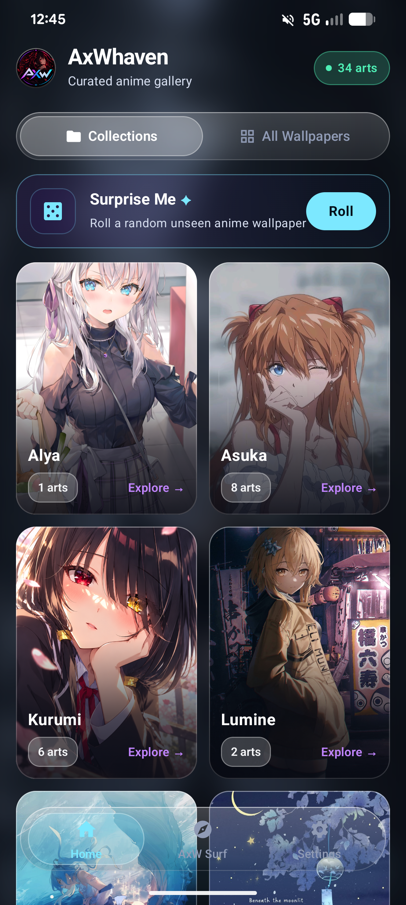
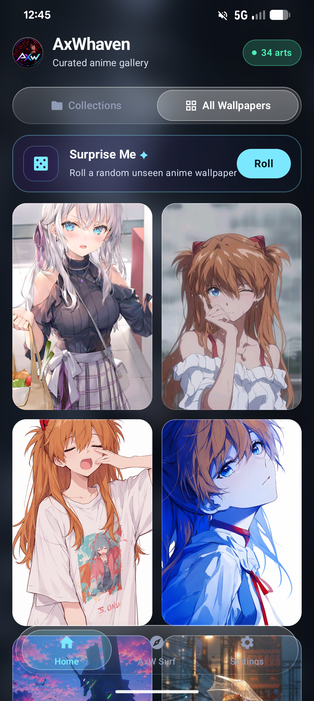
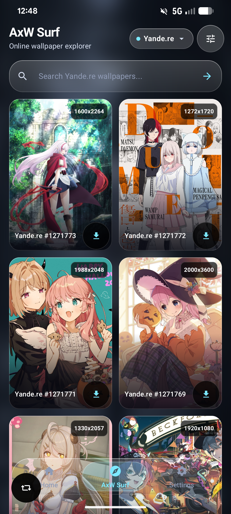
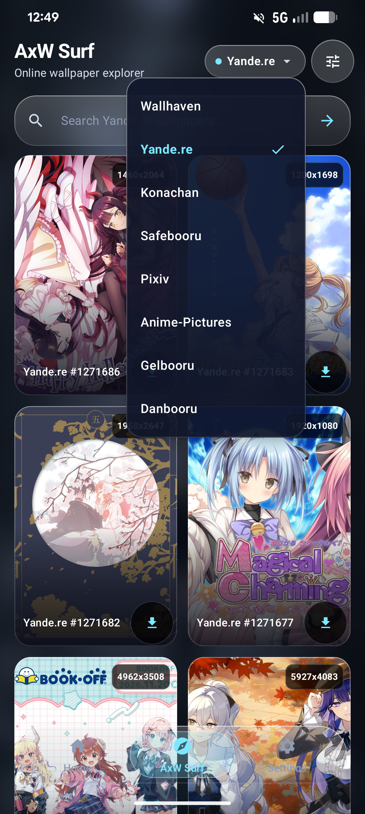
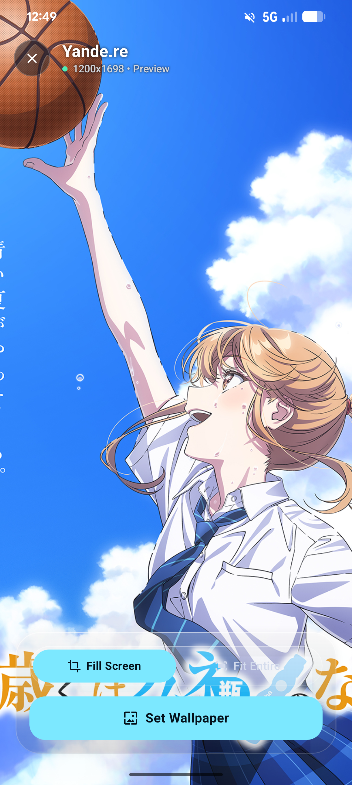
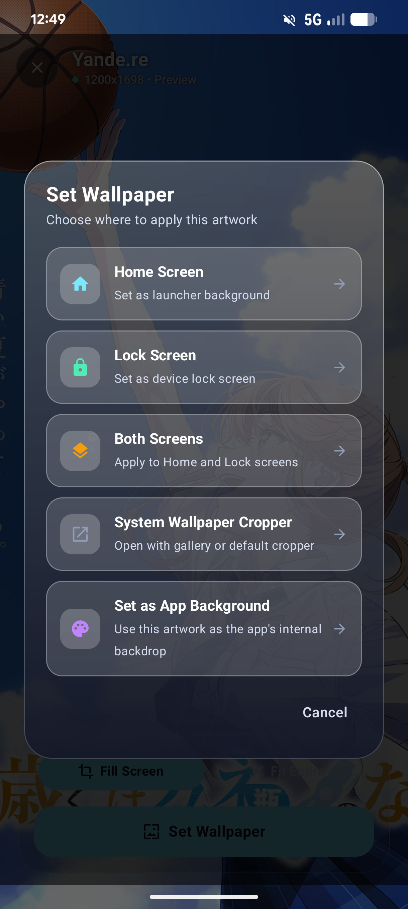
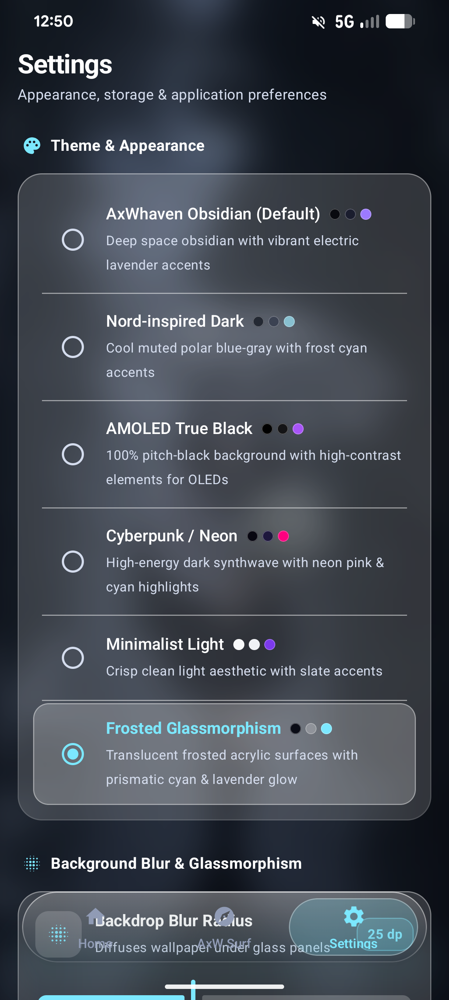
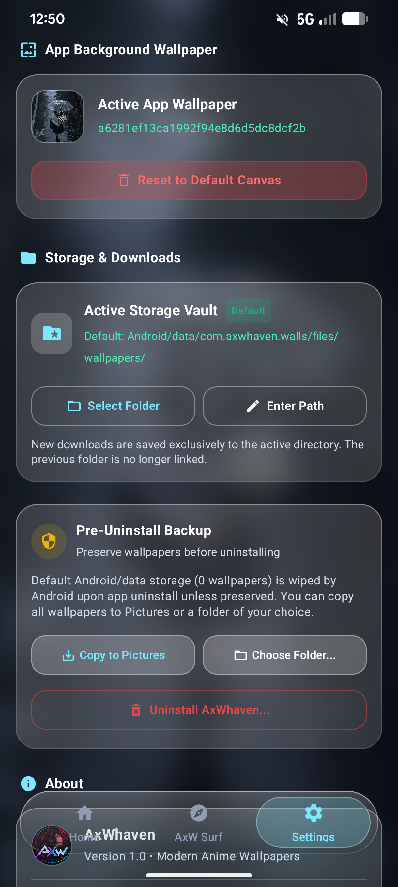

# AxWhaven

A clean anime wallpaper manager for Android with built-in collections and integration with major online image databases.

## Overview

- **Built-in Wallpapers**: Offline curated collections organized by series and characters.
- **Integrated Databases (AxW Surf)**: Browse and search wallpapers across Wallhaven, Safebooru, Danbooru, Gelbooru, Konachan, Yande.re, Anime-Pictures, and Pixiv.
- **Wallpaper Applier**: Set wallpapers directly to Home screen, Lock screen, or both.
- **Storage Management**: Download and organize wallpapers in your chosen local folder or external directory via SAF.

## Screenshots

### Home
| Home (Collections) | Collections Grid |
| :---: | :---: |
|  |  |

### AxW Surf
| Discovery Feed | Search & Filters |
| :---: | :---: |
|  |  |

### Wallpaper Set
| Preview Screen | Apply Options |
| :---: | :---: |
|  |  |

### Settings
| Preferences & Themes | Storage & Directory Settings |
| :---: | :---: |
|  |  |

## Contributors

- **[GreatLuv](https://github.com/GreatLuv)** — Creator & Maintainer
- **Gemini** (via Antigravity CLI, Google DeepMind) — Autonomous AI Pair Programmer

